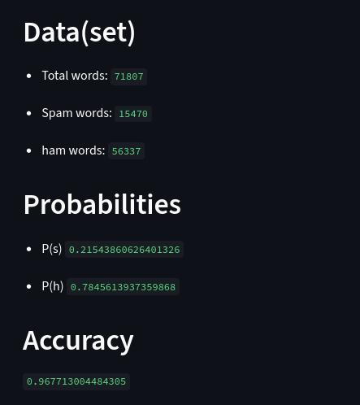

# Sms spam collection with Naive-Bayes

In this project I have applied Naive-Bayes form scratch in [Sms spam collection](https://www.kaggle.com/datasets/uciml/sms-spam-collection-dataset) dataset in kaggle. This markdown is just the overview of project and how I made this. I have given more detail in my [notes](https://github.com/gitbhusalhubpramish/ml-notes/tree/main/0.007%20navie-bayes) about Naive-Bayes.

This is the output of the model - There's not a lot to show in this model. It's hard to visulize. Main thing here is the accuracy and prob distribution which is hard to show in a graph.
